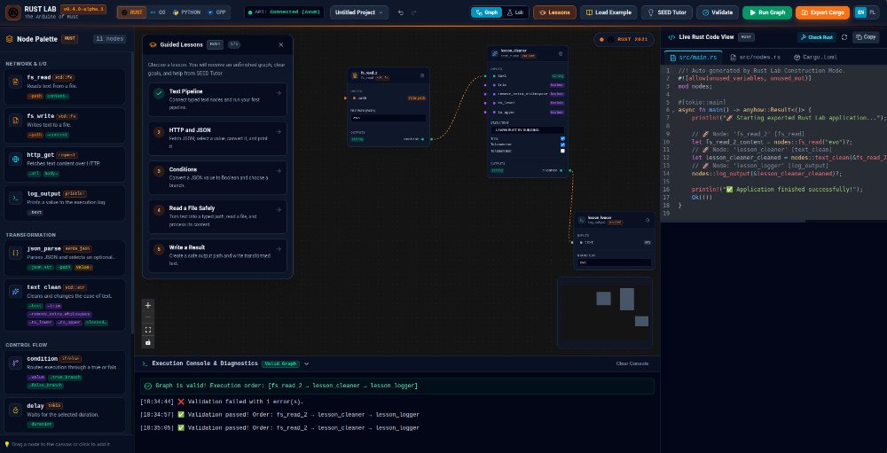

# Polyglot Lab

**Visual-to-Code Educational Platform · Learn, Build & Experiment with Rust, Go, Python, and C++**

[](https://github.com/jarohull-ai/rust-lab/releases)
[](#license)
[](https://buymeacoffee.com/HISTORYINANUTSHELL)
[](https://github.com/sponsors/jarohull-ai)

<p align="center">
  
</p>

Polyglot Lab is an interactive visual programming and prototyping environment. Beginners can connect typed
nodes and immediately inspect idiomatic code generated in **Rust**, **Go**, **Python**, or **C++**; intermediate
and advanced learners can open **Workspace Lab** to create native projects, import public GitHub repositories,
explore package ecosystems (`crates.io`, `pkg.go.dev`, `PyPI`, and CMake/C++ libraries), and run builds in a local sandbox.

> **Desktop Installers (Windows, macOS, Linux):**
> Ready-to-use standalone desktop installers (`.exe`, `.msi`, `.dmg`, `.AppImage`, `.deb`) are available under [**Releases**](https://github.com/jarohull-ai/rust-lab/releases). No terminal setup or cloud subscription required.

## Why Polyglot Lab?

Polyglot Lab joins three workflows that are normally split across unrelated tools:

- **Learn:** five guided lessons, typed visual connections, immediate validation, and a local deterministic SEED Tutor.
- **Build:** convert a valid graph into readable, idiomatic code across **Rust**, **Go**, **Python**, and **C++** with live syntax highlighting and one-click export.
- **Experiment:** work with real projects, public GitHub repositories, and package ecosystems without executing unverified imported code directly on the host.

No account, cloud service, API key, or LLM is required for the learning experience.

## Quick start

### Requirements

| Capability | Requirement |
|---|---|
| Graph editor, lessons, code generation | Rust stable, Node.js 22+, npm 10+ |
| Offline Cargo `check/test/run/clippy/fmt` | Bubblewrap on Linux **or** a running Docker service |
| Cargo dependency Fetch | A running Docker service and the local `rust:bookworm` image (`docker pull rust:bookworm`) |
| Public GitHub import and crates.io search | Internet connection |

Linux is the supported host platform for the v0.3.0 alpha. Other platforms can use the graph and
learning features, but the Cargo sandbox has not yet passed its release gate there.

From a fresh checkout:

```bash
./scripts/run-local.sh
```

Open <http://127.0.0.1:3030>. Use another port when needed:

```bash
PORT=3031 ./scripts/run-local.sh
```

The startup script checks the required tools, installs the locked UI dependencies when necessary,
builds the interface, and starts the API on loopback only.

## Product modes

### Graph — learn visually

- Build typed data-flow graphs with 11 nodes for I/O, parsing, conversion, control flow, and output.
- Catch missing inputs, incompatible types, invalid ports, and cycles before execution.
- Follow five guided lessons with live completion checks and browser-local progress.
- Receive adaptive SEED Tutor hints without sending code to an external model.
- Inspect generated Rust, run a real offline `cargo check`, and export a standalone Cargo ZIP.
- Save portable `.rustlab.json` projects with autosave and Undo/Redo.

### Lab — prototype with real Cargo projects

1. Create a binary package or import a public `https://github.com/OWNER/REPOSITORY` URL.
2. Browse and edit supported Rust, TOML, Markdown, JSON, YAML, and text files.
3. Search crates.io and add an explicitly selected dependency version.
4. Use **Fetch** to populate a project-specific dependency cache.
5. Run **Check**, **Test**, **Run**, **Clippy**, or **Fmt** offline in an isolated sandbox.

The Lab displays sandbox readiness before commands can be selected. Every dependency change and
Cargo command requires explicit confirmation. Private GitHub repositories and crates.io publishing
credentials are intentionally outside this alpha.

## Safety model

Rust Lab treats imported repositories, dependencies, generated code, and model-produced content as
untrusted.

- Imported Cargo code is never executed directly by the Rust Lab process.
- Offline commands prefer Bubblewrap and fall back to a hardened Docker container.
- The execution sandbox has no network, drops Linux capabilities, applies resource and time limits,
  and sees only the selected project and its dedicated dependency cache.
- Dependency Fetch uses a separate Docker phase with network access but without host Cargo
  credentials or external Git transport.
- Graph HTTP requests use an administrator-controlled domain allowlist.
- Graph file access is restricted to configured read/write directories.
- API requests are limited to 1 MiB; graph and Cargo execution have fixed timeouts.
- Cargo approvals and outcomes are recorded in a per-project `trajectory.jsonl` outside Git.

Read [SECURITY.md](SECURITY.md) before exposing Rust Lab beyond your own machine, and see the full
[security model](docs/SECURITY_MODEL.md) for boundaries and non-goals.

## Docker deployment

```bash
docker compose up --build
```

Compose publishes only on `127.0.0.1:3030` and runs Rust Lab as an unprivileged user without Linux
capabilities. It fully supports Graph mode, lessons, code generation, and browser exports.

The Compose container intentionally receives neither the host Docker socket nor additional
namespace privileges. Therefore real Cargo execution in Lab mode is reported as unavailable in the
standard Compose deployment. Mounting the Docker socket would grant excessive host control and is
not a supported workaround. Run Rust Lab directly on a Linux host for the complete v0.3.0 Lab
experience.

## Developer workflow

For frontend development:

```bash
# Terminal 1
cargo run -p api

# Terminal 2
npm --prefix ui ci
npm --prefix ui run dev
```

Run the same gate used by CI:

```bash
./scripts/verify.sh
```

It checks formatting, all Rust tests, Clippy with warnings denied, UI tests, and the production UI
build. Contribution instructions are in [CONTRIBUTING.md](CONTRIBUTING.md). Common setup failures
are covered in [docs/TROUBLESHOOTING.md](docs/TROUBLESHOOTING.md).

## Command-line workflows

Run a graph:

```bash
cargo run -p runtime -- examples/file_pipeline.json
cargo run -p runtime -- examples/web_scraper.json
```

Export a standalone Cargo project:

```bash
cargo run -p runtime -- --export ./my-app examples/web_scraper.json
cd my-app
cargo run
```

## Architecture

```text
rust-lab/
├── crates/
│   ├── lab-node-sdk/   # graph contracts, node trait, typed pins
│   ├── runtime/        # validator, planner, executor, codegen, tutor
│   └── api/            # Axum API, workspace isolation, static UI hosting
├── ui/                 # React, React Flow, CodeMirror, EN/PL localization
├── docs/               # specifications, decisions, security, user guidance
├── scripts/            # one-command local start and release verification
├── examples/           # runnable graph JSON files
└── data/               # local sample input and output
```

The public API contract is documented in [docs/specs/api-spec.md](docs/specs/api-spec.md). Design
decisions live in [docs/adr](docs/adr).

## Current limitations

- The supported release host is Linux.
- GitHub import supports public HTTPS repositories only.
- crates.io integration supports search and dependency addition, not authentication or publishing.
- Lab projects are stored locally under `target/rust-lab-workspaces/`; project management and
  migrations are still evolving.
- Rust Lab is a single-user local tool. It is not hardened as a multi-tenant remote code service.

See the [roadmap](docs/ROADMAP.md) for the deliberately limited post-alpha scope.

## Community and support

- Report reproducible bugs through [GitHub Issues](https://github.com/jarohull-ai/rust-lab/issues).
- Use the feature request template for product proposals.
- Report vulnerabilities privately according to [SECURITY.md](SECURITY.md).
- Read [SUPPORT.md](SUPPORT.md) for the support boundary.

## Support & Donations 💖

If you enjoy Polyglot Lab or find it helpful for teaching, programming, and learning, you can support further development:

- ☕ **Buy Me a Coffee:** [buymeacoffee.com/HISTORYINANUTSHELL](https://buymeacoffee.com/HISTORYINANUTSHELL)
- 💖 **GitHub Sponsors:** [github.com/sponsors/jarohull-ai](https://github.com/sponsors/jarohull-ai)

## License

Rust Lab is dual-licensed under either:

- [Apache License, Version 2.0](LICENSE-APACHE), or
- [MIT License](LICENSE-MIT),

at your option.

The official Rust logo is used unmodified under CC BY 4.0. Rust Lab is an independent project and
is not affiliated with or endorsed by the Rust Project or Rust Foundation. See
[NOTICE.md](NOTICE.md) for attribution and trademark information.
